# TaskBar Monitor

Widget para la barra de tareas de Windows 11 (y 10) que se ve como los íconos nativos: anillos de CPU y RAM, y
indicadores que aparecen solo cuando hay algo que mostrar.

| Indicador | Qué muestra | Clic |
|---|---|---|
| CPU y RAM | Anillo con el porcentaje. Al pasar el mouse: gráfico de 60 s y procesos que más consumen, con botón para detenerlos. | Administrador de tareas |
| Compilaciones | Mientras corre MSBuild: repositorio, rama y tiempo; al terminar, si salió bien. | Carpeta del repositorio |
| Claude | Sesiones de Claude Code y su estado (te pregunta, pide permiso, terminó, trabajando, error). | La sesión más urgente en la app de Claude |
| Jira | Tus tickets abiertos, agrupados y ordenados como elijas (ascendente o descendente). | La dirección configurada (o tus tickets) |
| Repositorios | Repos con cambios sin commit. | Carpeta del repositorio |
| Calendario | Siempre al final. Muestra el nombre y los minutos de la reunión en curso o de la próxima hora. | Unirse a la reunión |

Doble clic o clic derecho en el widget abre **Ajustes**, donde cada persona configura lo suyo. Todo se aplica al momento.
Para moverlo, arrastrarlo a lo largo de la barra de tareas: la posición se recuerda. Los íconos llevan un espaciado
con 10 px a cada lado (5 px en los anillos).

## Instalar

1. Descargar `TaskbarMonitor.exe` de la [última versión](https://github.com/NEObmonge/taskbar-monitor/releases/latest).
2. Abrirlo. Si Windows muestra "Windows protegió su PC", tocar **Más información → Ejecutar de todas formas**
   (la app no está firmada).
3. La app se instala sola para tu usuario, sin permisos de administrador, y abre **Ajustes** para configurar lo tuyo.

Para desinstalarla: **Configuración → Aplicaciones instaladas → TaskBar Monitor → Desinstalar**.

## Capturas

Las capturas son simuladas, con datos de ejemplo. Se generan con `tools\screenshots.cs` (compilarlo con `csc` y
ejecutarlo con la carpeta de salida, por ejemplo `docs\screenshots`).

**Barra de tareas** (claro y oscuro): CPU, RAM, Claude, Jira, repositorios y la próxima reunión.

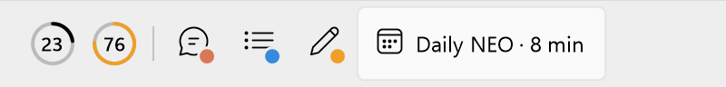
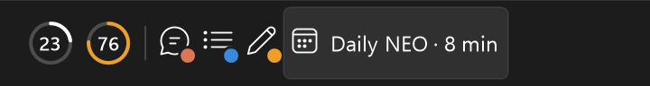

| | Claro | Oscuro |
|---|---|---|
| CPU y RAM | 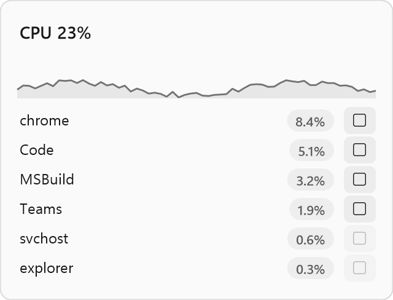 | 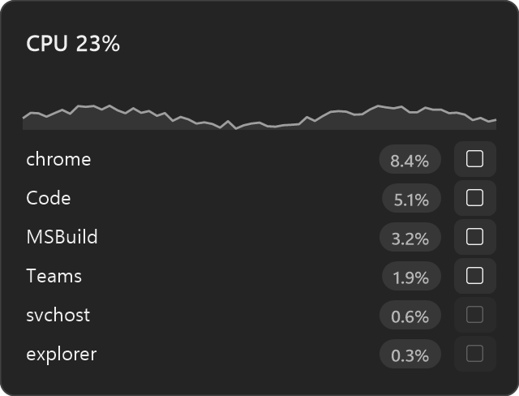 |
| Claude | 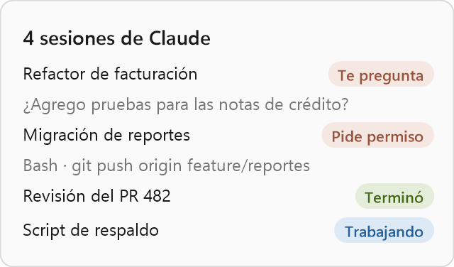 | 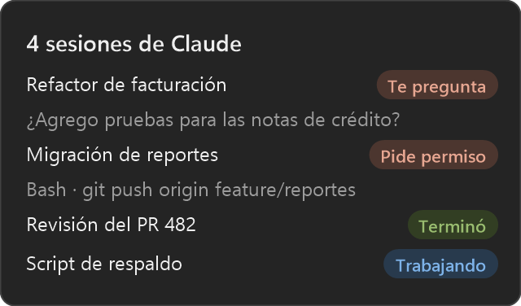 |
| Jira | 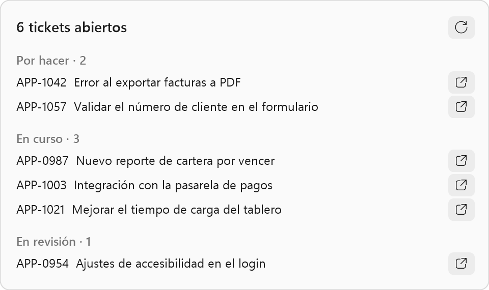 | 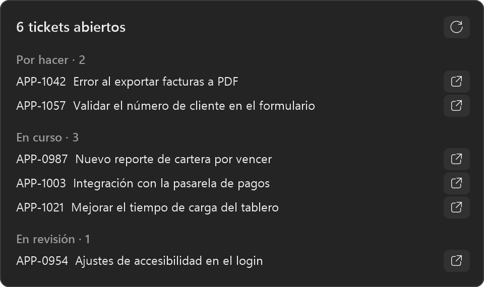 |
| Calendario | 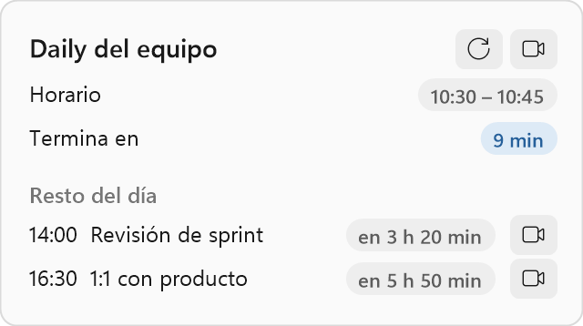 | 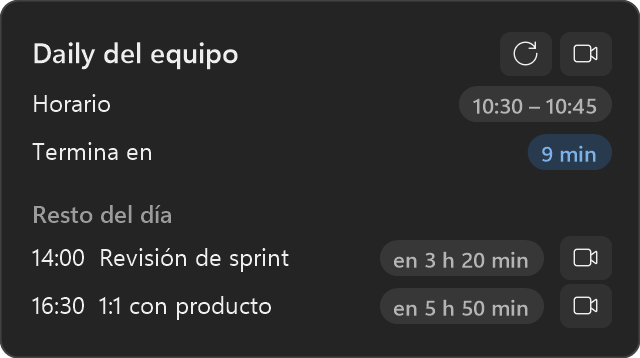 |
| Repositorios | 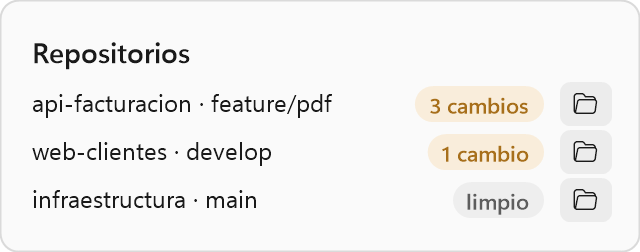 | 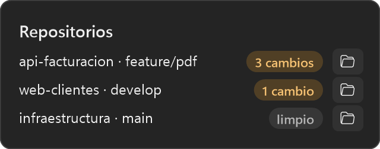 |

## Requisitos

- Windows 10 u 11.
- .NET Framework 4.8 (viene con Windows).
- Opcional: `git` en el PATH para el indicador de repositorios.

## Compilar e instalar

```powershell
.\build.ps1            # deja dist\TaskbarMonitor.exe
.\build.ps1 -Install   # además lo instala en %LOCALAPPDATA%\Programs\TaskbarMonitor y lo abre
```

No requiere Visual Studio: usa el `csc.exe` que trae .NET Framework.

Al arrancar, la app se registra sola para la persona actual (sin permisos de administrador):

- Inicio automático con Windows.
- Acceso directo en **Inicio → Todas las aplicaciones**.
- Entrada en **Configuración → Aplicaciones instaladas**, con su desinstalador.

La primera vez se abre **Ajustes**.

## Configuración por persona

Todo queda en `%LOCALAPPDATA%\TaskbarMonitor\config.ini`. El token de Jira y la sesión de Google se guardan cifrados con DPAPI: solo ese usuario de Windows en ese equipo puede leerlos.

- **Claude Code:** el interruptor "Conectar con Claude Code" agrega hooks en `~/.claude/settings.json` sin tocar los que ya existan. Los hooks ejecutan `TaskbarMonitor.exe --claude-hook`, que guarda el estado de cada sesión en `%LOCALAPPDATA%\TaskbarMonitor\claude`. Si la app se mueve de carpeta, los hooks se reparan solos al arrancar.
- **Calendario:** cuenta de Google (ver abajo) o la dirección secreta iCal de Google Calendar.
- **Jira (Cloud):** sitio (`tuempresa` o `tuempresa.atlassian.net`), correo y [token de API](https://id.atlassian.com/manage-profile/security/api-tokens).
- **Repositorios:** una o más carpetas. Cada una puede ser un repositorio o contener varios.

Jira se actualiza cada 5 minutos y el calendario cada 10, o al instante con el botón de actualizar de su tarjeta.

## Inicio de sesión con Google

La app usa el flujo OAuth para apps de escritorio (navegador, puerto local y PKCE), con permiso de **solo lectura** del calendario. El cliente OAuth es de Neotecnologías y tiene público **Interno**: solo pueden iniciar sesión cuentas @neotecnologias.com.

El `.exe` publicado trae el cliente incrustado. **El archivo no va en el repositorio**: para incrustarlo al compilar,
dejar `google-oauth.json` junto a `build.ps1`; también sirve ponerlo junto al `.exe` (tiene prioridad). Sin cliente,
la fila de Google en Ajustes lo indica y se puede usar la dirección iCal.

Para crear un cliente en otra organización:

1. En [Google Cloud](https://console.cloud.google.com) crear un proyecto y activar **Google Calendar API**.
2. En **Google Auth Platform**, configurar el público como **Interno**, para que solo lo usen cuentas de la organización sin revisión de Google.
3. En **Clientes**, crear un cliente de tipo **App de escritorio** y descargar el JSON como `google-oauth.json`.

## Otros modos del ejecutable

| Comando | Para qué |
|---|---|
| `TaskbarMonitor.exe` (ya abierto) | Abre Ajustes de la instancia que está corriendo |
| `--claude-hook` | Lo ejecuta Claude Code en cada evento (lee el JSON por stdin) |
| `--hooks-install [archivo]` / `--hooks-uninstall [archivo]` | Conecta o desconecta Claude Code |
| `--uninstall` | Desinstala: lo ejecuta Windows desde Aplicaciones instaladas |

Los errores inesperados quedan anotados en `%LOCALAPPDATA%\TaskbarMonitor\errores.log` y la app sigue funcionando.

## Ícono

`app.ico` se genera con `tools\make_icon.cs`: compilarlo con `csc` y ejecutarlo con la ruta de salida.

## Limitaciones conocidas

- Solo usa la barra de tareas del monitor principal.
- Jira Server/Data Center no está soportado (usa la API de Jira Cloud).
- Con la dirección iCal, los eventos en zonas horarias poco comunes pueden verse corridos; con la cuenta de Google no pasa.
- Abrir una sesión concreta de Claude depende del enlace `claude://code/continue` de la app de escritorio.
- La interfaz está en español.
